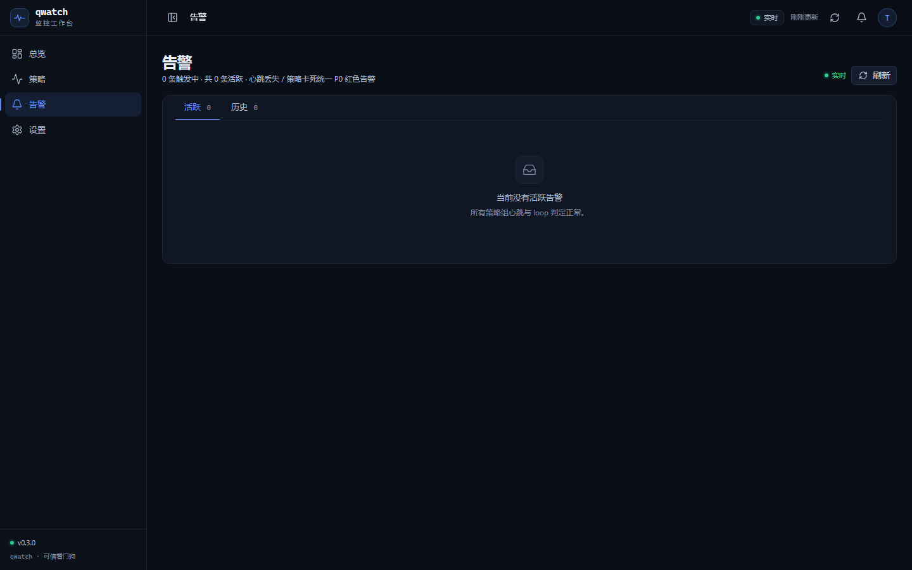
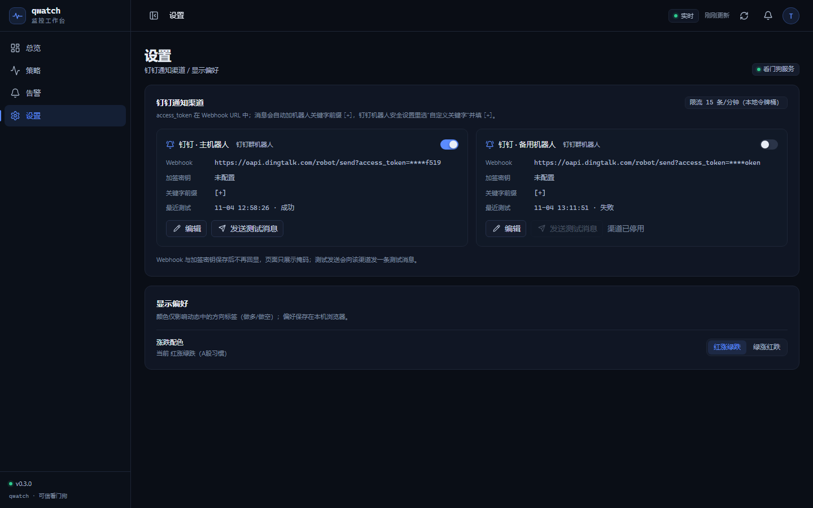

# qwatch

自托管的**策略进程看门狗**：一个策略组下可以有多个进程，进程掉线或 loop 卡死时发 P0 钉钉告警，并在网页上实时看到「谁、什么时候、因为什么」出事。

> v0.3 专注存活监控，并加入策略组权益。**不包含 PnL / 收益 / 回撤 / 风险指标 / 资金流水 / 交易日历**。

## 核心概念

| 概念 | 含义 |
|---|---|
| 策略组 | 一个 strategy token |
| 进程 instrument | 策略组下的独立上报源，例如 `rb`、`ag`、`IF`，不是合约号 |
| 合约 contract | 信号里的实际合约，例如 `rb2507` |
| 告警 | 进程心跳丢失 / loop 连续 3 次不增长，统一 P0 |
| 动态 | 消息 + 信号合并时间线，不触发 P0 |

一个 token 可以挂 30 个进程。进程由第一次上报自动发现，不需要提前建清单。

## 功能

- 策略组 / 进程存活看板
- 策略组权益（由进程上报，同一 token 最后一次为准）
- 进程级心跳、loop 卡死检测
- 组级 P0 告警 + 钉钉投递（关键词 `[+]`、加签、重试、恢复通知）
- 告警中心实时刷新（SSE），确认 / 静默 / 历史
- 动态时间线：消息 + 信号实时合并
- 暂停策略、停用/恢复进程
- SDK 每个进程独立本地日志
- 移动端适配

## 界面


| 策略 | 策略详情 |
|---|---|
|  |  |

| 告警 | 设置 |
|---|---|
|  |  |

## 快速开始

### 1. 环境

- Python 3.11+
- Node.js 20+（只在需要重新构建前端时使用）

### 2. 安装后端依赖

```bash
cd qwatch
python -m pip install -r backend/requirements.txt
```

### 3. 初始化基础数据

```bash
python -m backend.seed
```

> `seed` 会清空运行时数据并写入演示钉钉渠道。第一次初始化运行一次即可。
> 如果已有数据，先备份 `data/qwatch.db`，不要重复运行 seed。

### 4. 启动

```bash
python -m backend
```

打开 `http://127.0.0.1:8080`，默认密码 `qwatch`。

可覆盖环境变量：

```bash
set QWATCH_PASSWORD=your-password
set QWATCH_PORT=8080
python -m backend
```

### 5. 创建策略并拿到 token

打开「策略」→「新建策略」：

- 填写策略名
- 创建成功后弹窗显示一次性 token
- 同一策略组下所有进程共用这个 token

### 6. 安装 Python SDK

```bash
python -m pip install -e sdk/python
```

### 7. 进程接入

每个进程初始化时填自己的稳定进程名，只填一次：

```python
from qwatch import Qwatch

q = Qwatch(
    "http://127.0.0.1:8080",
    token="qw_xxxxxxxx",
    instrument="rb",       # 稳定进程名，不是 rb2507
    log_dir="logs",         # 自动生成 logs/rb.log
)

while True:
    q.tick()                # 主循环每轮：服务端据此判断 loop 卡死
    q.equity(1_002_300)     # 策略组权益；任意进程可报，最后一次为准
    q.msg("夜盘流动性差")    # 普通动态，不触发 P0
    q.signal(               # 交易信号，不触发 P0
        contract="rb2507",
        direction="long",
        action="open",
        qty=10,
        price=3521,
    )
```

自动心跳由 SDK 后台线程完成。

### 8. 多进程共用一个策略 token

```python
rb = Qwatch(url, token, instrument="rb", log_dir="logs")
ag = Qwatch(url, token, instrument="ag", log_dir="logs")
if_q = Qwatch(url, token, instrument="IF", log_dir="logs")
```

换月时进程名保持 `rb`，只改信号里的 `contract=rb2507`，不会产生旧进程告警。

### 9. 本地日志

默认：

```text
logs/rb.log
logs/ag.log
logs/IF.log
```

自定义 `log_path`：

```python
Qwatch(..., instrument="rb", log_path="logs/rb-2026.log")
```

日志含时间、instrument、动作、HTTP 状态、耗时、重试、错误；不含 token；默认 5MB 轮转 3 份。

## 权益

- 权益是**策略组级**，不是品种级
- 任意进程可调用 `q.equity(1_002_300)`，后端以最后一次为准
- 总览展示组合权益曲线、总权益、今日权益变动
- 策略组卡片和详情展示最新权益
- 没有 PnL / 收益 / 回撤 / 风险指标

## 告警规则

只保留两类 P0：

1. 进程心跳丢失
2. 进程 loop 连续 3 次不增长

- 按策略组汇总为一条告警，摘要列出进程名
- 钉钉实时发送
- 恢复后自动 resolved
- 告警中心支持确认 / 静默 / 历史
- 消息和信号不会触发 P0

## 钉钉配置

「设置」→ 钉钉渠道：

- 填写 Webhook 地址
- 加签则填 SEC 开头密钥
- 机器人安全设置选「自定义关键字」，填 `[+]`
- 消息自动加 `[+]` 前缀
- 不使用 @手机号
- 保存后可发送测试消息

演示渠道（webhook 含 `demo-`）不会真正出网。

## 目录结构

```text
qwatch/
├─ backend/                 FastAPI + SQLite + SSE
│  ├─ app.py                API / 上报 / 告警 / 静态托管
│  ├─ db.py                 schema + v0.1→v0.3 迁移
│  ├─ notify.py             钉钉投递 / 重试 / 投递日志
│  ├─ sse.py                实时事件总线
│  └─ seed.py               初始化渠道
├─ frontend/                Vue 3 + Vite + Naive UI
│  ├─ src/views/            总览 / 策略 / 告警 / 设置 / 登录
│  └─ dist/                 build 后由后端托管
├─ sdk/python/qwatch/       Python SDK
├─ sim/                     三策略模拟器
├─ data/                    运行时 SQLite（gitignored）
└─ screenshots/             README 截图
```

## 开发

```bash
cd frontend
npm install
npm run typecheck
npm run build

cd ..
python -m compileall -q backend sdk sim
```

模拟器：

```bash
python -m backend
python -m sim.run
```

模拟器通过真实 API 创建 3 个策略组、4 个进程，持续发送心跳、tick、消息和信号；不发 PnL / 净值。

## 数据与备份

- 数据库：`data/qwatch.db`（gitignored）
- 升级前备份：

```powershell
Copy-Item data/qwatch.db data/qwatch.backup.db
```

- v0.3 启动时会自动迁移 v0.1/v0.2 数据库；旧 PnL/资金/日历表删除，旧合约进程标记 retired，新增策略权益表。
- 部署必须单 worker：SSE / 告警 / 限流为进程内状态。

## 已知限制

1. 没有交易日历：不做 A 股/期货休市判断。策略收盘后停止 tick/心跳会被判离线；需要策略端继续 tick，或手动暂停策略。
2. 每天只跑一次、跑完退出的策略会被判离线。需要策略端保持轻量循环发送 tick/心跳。
3. 没有进程清单：只监控已经上报过的进程，无法发现从未启动过的进程。
4. 旧 v0.1 合约进程（如 `rb2601`）会自动 retired；新 SDK 使用稳定名 `rb`。
5. 不提供 PnL / 净值 / 收益 / 风险 / 资金 / 账户 / 日历功能。

## License

Apache-2.0
