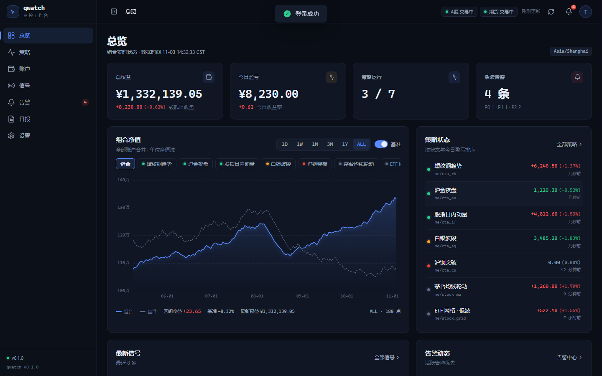
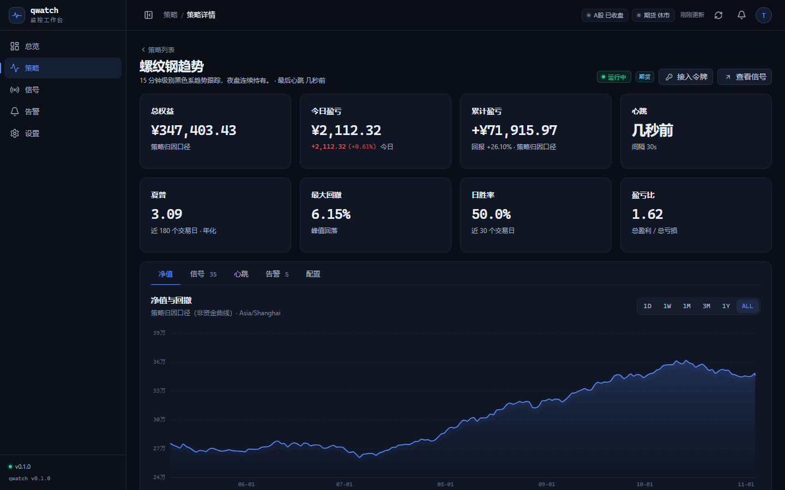
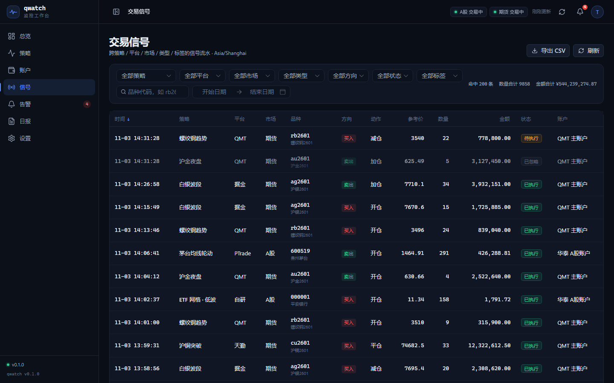
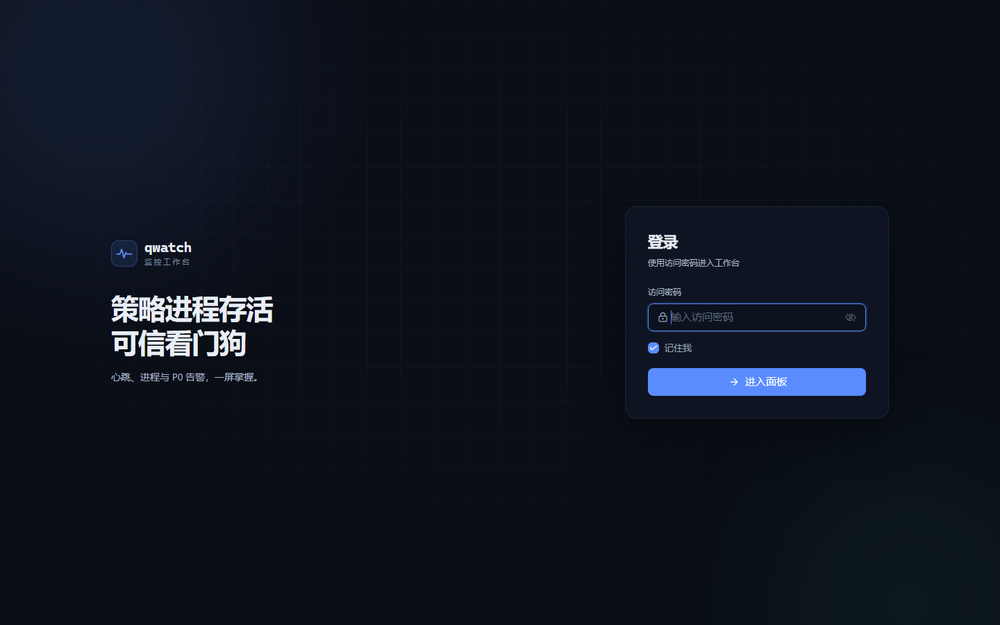
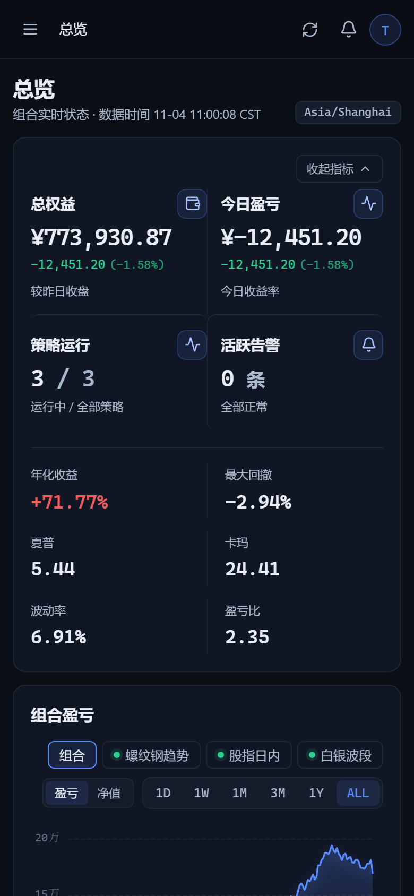

# qwatch

**多策略 / 多市场 / 多账户的监控工作台**：净值曲线、交易记录、策略存活 watchdog 与钉钉告警。自用，开源。

## 功能

- **总览**：组合净值一屏看清，可快速切到单个策略查看净值/收益曲线；今日盈亏、策略状态、活跃告警
- **策略**：净值与回撤、成交、持仓、心跳可用率、告警历史
- **账户**：按单位净值法展示，出入金不扭曲收益；持仓与资金流水
- **交易信号**：按策略 / 平台 / 市场 / 类型 / 标签 / 方向 / 状态筛选，排序、分页、导出 CSV
- **告警**：P0/P1/P2 分级，确认与静默；心跳丢失、卡死、行情断流、回撤超限等规则
- **日报**：收盘复盘，按策略归因

## 界面



| 策略详情 | 交易信号 |
|---|---|
|  |  |

| 登录 | 手机 |
|---|---|
|  |  |

## 架构

```
策略进程（任意语言）
   │  POST /heartbeat        每 10s
   │  POST /events           订单/成交/持仓/净值（批量、幂等）
   ▼
FastAPI + SQLite ──▶ Watchdog（心跳/进度/交易日历）──▶ 告警引擎 ──▶ 钉钉
   │
   └──▶ Vue 3 面板（总览 / 策略 / 交易 / 告警 / 日报）
```

- 纯推送：策略不需要被扫描、不需要开放端口；服务端只认「有没有按时报到」。
- 只读：服务端没有任何下单能力。
- 单机：一台交易机 / NAS / VPS 即可，数据保存在本地 SQLite。

技术栈：Vue 3 + TypeScript + Vite + Naive UI + ECharts（前端）；FastAPI + SQLite（后端，开发中）。

## 快速开始（前端）

```bash
cd frontend
npm install
npm run dev                  # http://127.0.0.1:5173
# 或构建后单进程预览
npm run build
node mock-server.mjs         # http://127.0.0.1:8080
# 登录密码：qwatch
```

前端当前使用内置演示数据（真实 HTTP 接口，便于后端按同一契约替换）；后端尚未开始。

## 目录

```
frontend/        前端（Vue 3 + Naive UI + ECharts）
screenshots/     界面截图
```

## License

[Apache-2.0](LICENSE)
