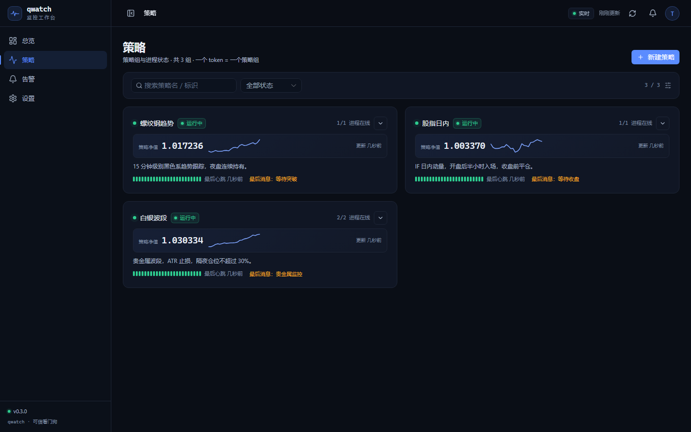
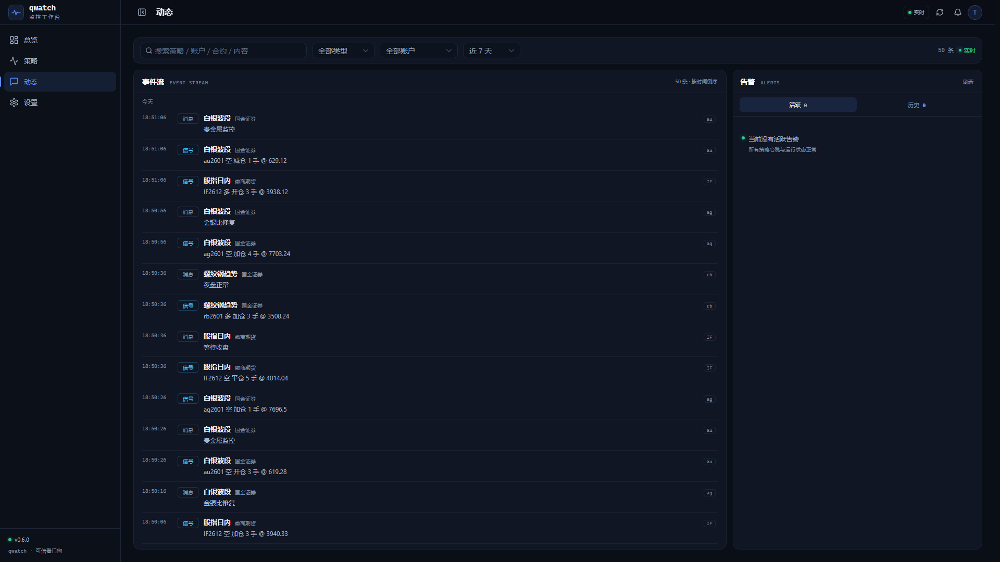

# qwatch

自托管的**策略进程看门狗 + 策略权益看板**：账户只是策略的自然分组，策略下可有多个进程；进程的 heartbeat/消息/信号/权益都归属策略，账户权益由下面策略相加。

> v0.6：策略级权益；账户自动分组并汇总；无独立账户导航页，点击策略页的账户头进入账户详情。


## 核心模型

```text
账户（国金证券 / 徽商期货）
└─ 策略（一个 token）
   ├─ 进程 rb
   ├─ 进程 ag
   └─ 进程 au
```

- 账户：券商的自然分组，只用于归类策略
- 策略：一个 token；同策略下多个进程共用
- 进程：稳定 instrument 名（rb/ag/IF），不是合约号
- 策略权益：该策略进程上报，last-wins；账户权益 = 下面策略权益之和
- 告警：进程心跳丢失 / loop 卡死，按策略组汇总 P0

## 功能

- 策略页按账户分组：账户头显示聚合权益/sparkline；整卡点击进入账户详情
- 账户详情：账户权益曲线、所属策略卡片
- 策略卡片：策略权益、账户/券商、sparkline、整行心跳、进程数/异常
- 总览：左权益曲线 + 右策略状态卡片；曲线可选全部账户/单账户/单策略，可切换权益/盈利额，全部历史按日粒度
- 小图：策略 sparkline、账户 sparkline、心跳条统一展示最近 7 天；心跳为 28 个 6 小时桶，悬停查看时间段与可用率
- 大图：详情页支持全部/1M/3M/6M/1Y/3Y/5Y/自定义范围
- 今日盈利额：总览、账户头、策略卡展示今日权益变动金额
- 详情：无 Tab；左进程/告警，右动态（搜索 + 全部/消息/信号筛选 + 滚动）
- 动态中心：左侧全局事件流（消息/信号，分页滚动），右侧活跃/历史告警，可直接确认告警
- SSE 实时告警/动态；钉钉 P0 投递/重试/恢复
- 生产安全 SDK

## 快速开始

```bash
python -m pip install -r backend/requirements.txt
python -m backend.seed
python -m backend
```

打开 `http://127.0.0.1:13337`，首次启动会进入「初始化密码」界面，设置至少 10 位密码后进入。

1. 「策略」→ 新建策略
2. 账户可下拉已有，也可直接输入新账户名（自动创建）
3. 保存弹窗里的一次性 token

## SDK

```bash
python -m pip install -e sdk/python
```

```python
import time
from qwatch import Qwatch

q = Qwatch("http://127.0.0.1:13337", token="qw_xxx", instrument="rb", log_dir="logs")
while True:
    q.tick()
    q.msg("夜盘正常")
    q.signal(contract="rb2607", direction="long", action="open", qty=1, price=3521)
    q.equity(1_000_000)   # 所属策略权益
    time.sleep(10)
```

SDK v0.6 生产安全：

- 构造不阻塞，不做同步网络请求
- `tick/msg/signal/equity` O(1) 入队，不阻塞、不因网络失败抛异常
- 单 daemon worker：自动心跳 + 指数退避+抖动重试
- 有界队列，满时丢最旧；每 instrument 独立日志 5MB×3，不记 token
- 401 标记 `auth_failed`，不影响调用方
- `close(flush_timeout)` 有上限；`stats/last_error` 可观测

## 单行 SDK（无法 pip 安装的环境）

如果目标机器不能安装包，直接复制 [sdk/python/qwatch/oneline.py](sdk/python/qwatch/oneline.py) 中的**一整行**源码粘贴执行即可。

- 只用 Python 标准库
- 仍然后台线程、非阻塞入队
- 支持 `tick / msg / signal / equity / close`
- 单行代码约 1.3KB

```python
# 粘贴 oneline.py 的整行后：
q = Qwatch("http://127.0.0.1:13337", "qw_xxx", instrument="rb")
q.tick(); q.msg("hello")
q.close()
```

## 权益口径

- 策略权益由该策略进程上报，last-wins
- 账户权益 = 该账户下所有策略最新权益之和
- 总权益 = 所有策略权益之和
- 策略详情显示策略自身权益；账户信息在顶部/卡片中展示

## 界面

| 策略（按账户分组） | 详情 |
|---|---|
|  |  |

| 总览 | 动态中心 |
|---|---|
|  |  |

## 每日盈利额（第一阶段）

- 今日盈利额 = 当前权益 − 今日基线权益
- 已展示在总览 KPI、账户头、策略卡
- 权益/盈利大图为全部历史、按自然日粒度；小图为最近 7 天

## 存储与性能

- 原始权益点只保留最近 30 天，供最近明细与回溯
- 每日权益长期保留（每策略每天 1 行），支撑 5 年大图
- 心跳可用率按 6 小时桶保留 30 天
- 动态事件保留 180 天
- 看门狗按小时执行清理，策略数量增长时存储保持可控

## 告警与钉钉

- P0：进程心跳丢失 / loop 连续 3 次不增长
- 「设置」→ 单个钉钉主渠道：Webhook、SEC 加签、关键字 `[+]`；无备用机器人，无显示偏好
- 消息/信号不会触发 P0
- 演示渠道（webhook 含 `demo-`）不会出网
- 导航：总览 / 策略 / 动态 / 设置；事件流与告警合并到动态中心

## 模拟器

```bash
python -m backend
python -m sim.run
```

2 个账户：

- 国金证券：螺纹钢趋势、白银波段（ag/au 双进程）
- 徽商期货：股指日内

## 开发

```bash
cd frontend
npm install
npm run typecheck
npm run build

cd ..
python -m compileall -q backend sdk sim
```

## 备份/迁移

- 数据库 `data/qwatch.db`（gitignored）
- 升级前：`Copy-Item data/qwatch.db data/qwatch.backup.db`
- v0.6 自动迁移 v0.4/v0.5：
  - 账户权益迁移到该账户最早策略
  - 新增策略级权益曲线
  - 删除账户权益存储
  - 账户权益改为策略求和
- 迁移不可回退，请先备份
- 部署保持单 worker

## 已知限制

1. 没有交易日历，策略需要持续 tick
2. 每天只跑一次、跑完退出的策略会被判离线
3. 无显式进程清单，只监控上报过的进程
4. 账户权益是策略权益求和；策略权益 last-wins
5. 不提供 PnL/收益/回撤/风险指标/资金流水

## License

Apache-2.0

## 设计规范

- [字体与排版规范](docs/UI-TYPOGRAPHY.md)

- [安全说明](SECURITY.md)
